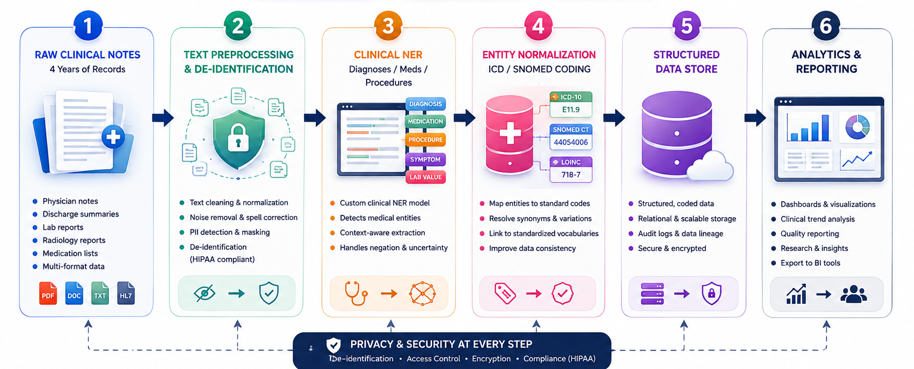

# Clinical NLP for Structuring Hospital Records

---

## Overview

Most clinical information lives in free-text notes — diagnoses, medications, procedures, and outcomes buried in physician narratives rather than structured fields. This pipeline is designed to read through years of hospital records, extract the clinically meaningful entities, and organize them into structured data that can actually be queried, analyzed, and reported on.

---

## Aim

- Extract key clinical entities — diagnoses, medications, procedures, and lab values — from unstructured hospital notes
- Normalize extracted entities against standard medical coding systems (e.g. ICD, SNOMED)
- De-identify patient data to protect privacy before any downstream processing
- Convert years of disconnected text records into a single structured, analyzable dataset

---

## Key Features

- Named Entity Recognition tuned for clinical language (diagnoses, medications, procedures, symptoms)
- De-identification of protected health information before structuring or storage
- Entity normalization and coding against standard clinical vocabularies
- Handles multi-year, multi-format hospital records at scale
- Structured output ready for downstream analytics and reporting

---

## Benefit

- **Unlocks buried clinical data** — years of physician notes that were previously unsearchable become structured data hospitals can actually query and analyze
- **Improves patient care insights** — structured diagnosis, medication, and procedure data supports better clinical decision-making and population health analysis
- **Protects patient privacy** — de-identification is built into the pipeline before any data is stored or analyzed, keeping the process compliant by design
- **Saves manual coding effort** — automatic entity normalization against ICD/SNOMED removes hours of manual chart review and coding
- **Supports research and reporting** — structured, standardized data can directly feed quality reporting, clinical research, and audit requirements
- **Applies beyond hospitals** — the same NER and normalization approach extends to insurance claims processing, pharmacovigilance, and any domain where clinical text needs to become structured data

---

Turning years of clinical narrative into data that can actually be used.
